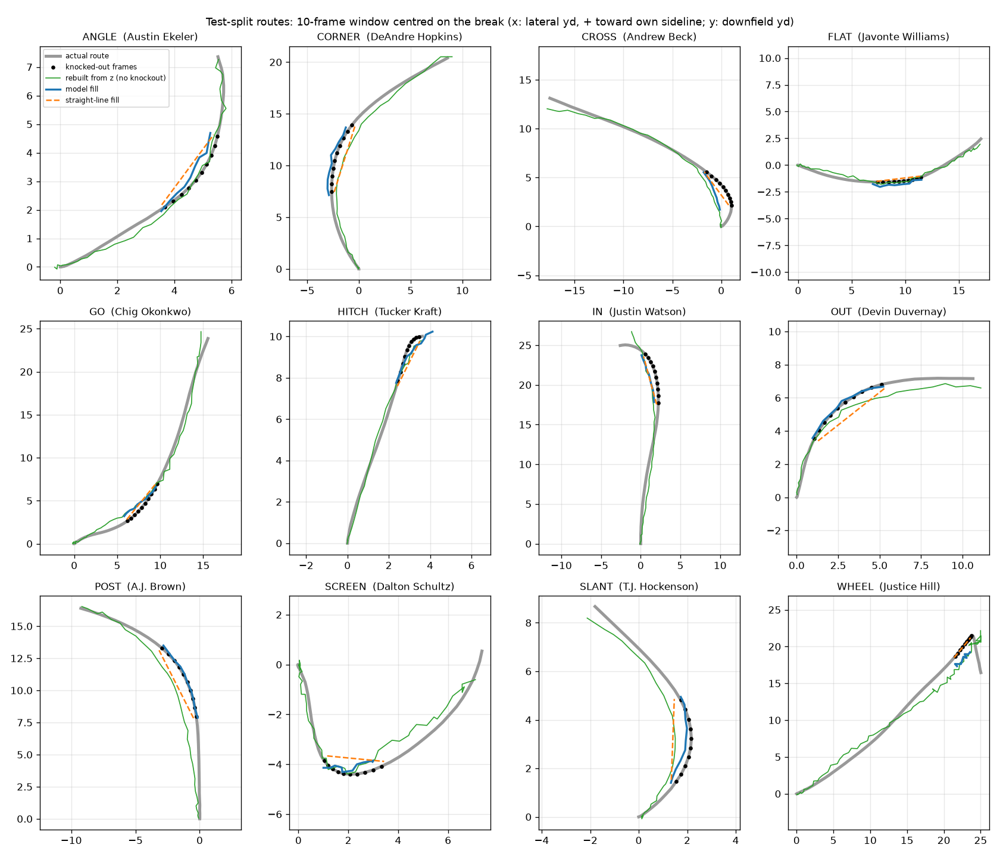
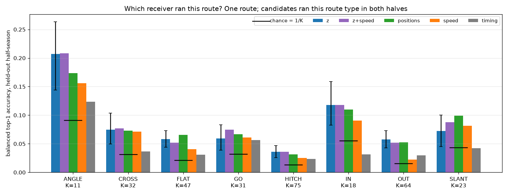
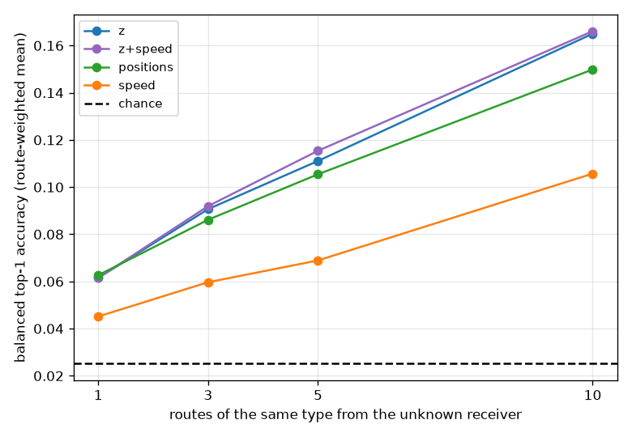
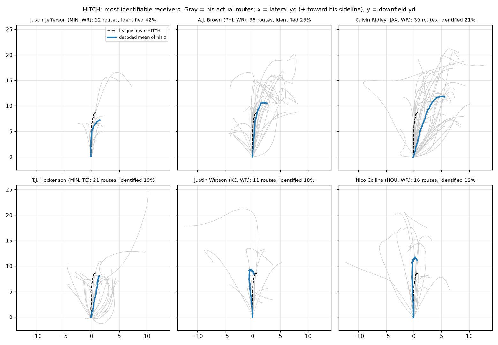

# Route Embedding: masked-window route autoencoder

**Final question:** can we identify a receiver by how he runs a certain route?

Each route becomes a 16-number vector **z**, learned without labels. The model sees only the route
(positions, speed, acceleration; never the player). Training knocks out a window of the route,
and the model has to rebuild the whole route, including the missing window, **from z alone**.
The receiver-identification experiments then work on z.

```
route with a window knocked out -> Encoder (Transformer) -> z (16 numbers) -> Decoder -> whole route
                                                                     ^
                                    the decoder sees only z and "which time step"; no input frames
```

If the decoder could see the frames next to the gap, it could fill the gap by drawing between
them, and z would not need to hold the route. Decoding from z alone forces z to describe the
stem, break depth, direction, sharpness and speed profile, so similar z means similar route.

## Data (`build_sequences.py`)

The source is the Step 2.0 targeted full paths (snap to ball arrival), the 14,108 complete
routes. QB, CB and lineman targets (60) are excluded. That leaves **14,048 routes from 458
players**, 14,047 of them labeled.

- **Coordinates:** yards from the receiver's snap position, +x downfield, +y toward his own
  sideline. The side is `side_corrected` from the reviewed break features v2, which flips 313
  RB/FB or near-ball routes.
- **Channels:** `x, y, vx, vy, s, a`. Velocity, speed and signed tangential acceleration are
  recomputed from smoothed positions (`[1,4,6,4,1]/16`, the same smoother as `route_geometry.py`)
  for every frame. The official `a` exists only before the throw and is unsigned, while the
  post-throw values are noisy differences. The recomputed speed matches the official pre-throw
  speed with r = 0.999 (median difference 0.05 yd/s).
- **Length:** padded to **77 frames** (7.6 s). This covers 99.2% of routes, and the 107 longer
  routes are truncated. Median length is 37 frames.
- **Split:** by game, 218/27/27 games (11,387 / 1,387 / 1,274 routes).
- **Metadata:** player, team (`possession_team`), position and label are stored only in
  `routes_meta.csv`, for evaluation. They are never model inputs.

Outputs (ignored by Git) are `data/sequences.npz`, `data/routes_meta.csv` and
`data/build_report.json`, which holds all counts and validation checks.

## Window knockout (`masking.py`)

Each training route loses one contiguous window:
- **Width:** uniform on 8–15 frames (0.8–1.5 s), capped at half the route.
- **First frame:** uniform over the route's real frames, so windows never land in padding but can
  reach the last frame.

Single frames are not used, because routes are smooth. Straight-line interpolation fills short
gaps almost perfectly, measured on all 14,108 routes:

| window | share of median route | straight-line error, median | worst position (usually the break) |
|---|---|---|---|
| 5 frames (0.5 s) | 14% | 0.13 yd | 0.21 yd |
| 10 frames (1.0 s) | 27% | 0.38 yd | 0.59 yd |
| 15 frames (1.5 s) | 41% | 0.71 yd | 1.04 yd |
| 20 frames (2.0 s) | 54% | 1.08 yd | 1.50 yd |

A break takes a median of 1.0 s (IQR 0.8–1.2 s) to complete 80% of the turn, so 8–15 frames can
hide most of a break without removing most of the route. The width range is a hyperparameter;
choose it by how well z identifies route type and receiver on validation data, not by
reconstruction error, which always grows with width.

## Model (`model.py`)

- **Encoder:** one token per frame (inputs `x, y, s, a`, scaled). Knocked-out frames are replaced
  by a learned mask token, and a learned time embedding and a [CLS] token are added. Three
  Transformer layers (d_model 64, 4 heads, pre-norm) produce z = Linear([CLS]), with 16 dimensions.
- **Decoder:** one query per time step = time embedding + Linear(z), then three Transformer
  layers over the route's real steps, outputting `x, y`.
- **Loss:** squared error on the knocked-out frames plus 0.5 × the error on the visible frames.
  Padding is ignored. x and y share one scale, so the loss tracks Euclidean error in yards.
- **Size:** 213,650 parameters. Dropout defaults to 0, because CPU dropout sampling took about 60%
  of each step and the random knockout already acts as augmentation.

Tests check that knocked-out and padded frames cannot reach z, that visible frames do, and that
the forward pass has no path around z.

## Run

```powershell
python build_sequences.py                    # data/ (refuses to overwrite without --overwrite)
python -m unittest discover -s . -p "test_*.py" -v
python train.py --name v1 --epochs 80 --patience 20
python evaluate.py --run-dir runs/v1
python identify_receivers.py --run-dir runs/v1   # writes runs/v1/identification/
```

`train.py` writes `runs/<name>/model.pt` (best validation checkpoint), `history.csv` and
`summary.json`. `evaluate.py` writes the following to the run folder:
- `eval_report.json`;
- `embeddings.csv`: z for every route, with player, team, label, week and split;
- `reconstructions.png`.

The evaluation compares the model with straight-line fill on 5/10/15-frame windows, at random
positions and centred on the break. It also reports whole-route reconstruction from z, and kNN
route-type accuracy of z against raw positions at six fixed times.

**Environment.** Python 3.14 and PyTorch 2.15.0 (CPU) run on Windows with 10 threads, at about
26 s per epoch. On this machine Smart App Control blocked the first `import torch`
(`WinError 4551`, `torch_python.dll`), and later imports worked. If the error comes back, check
Windows Security → App & browser control, or run in WSL or Colab.

## First results (`runs/v1`)

The model trained for 80 epochs (34 minutes); the best checkpoint is epoch 79. On validation, the
mean error per frame is 0.51 yd in the knocked-out window and 0.47 yd on the visible frames.
Below are test-split results (1,274 routes from 27 unseen games), as the median error per route
in yards:

| window | model | straight line | model better |
|---|---|---|---|
| 5 frames, random position | 0.29 | 0.13 | 15% |
| 10 frames, random position | 0.32 | 0.38 | 54% |
| 15 frames, random position | 0.41 | 0.71 | 71% |
| 10 frames, centred on the break | 0.36 | 0.56 | 72% |
| 15 frames, centred on the break | 0.55 | 1.03 | 82% |
| whole route rebuilt from z, nothing knocked out | 0.40 (p90 0.71) | – | – |

- **At the break the model roughly halves the straight-line error.** For 15-frame break windows,
  the model/line ratio is 0.38–0.43 for IN, SLANT, OUT and POST, and about 0.6 for HITCH, CORNER
  and CROSS. The model is not better on GO (already nearly straight), SCREEN or WHEEL (301 and 76
  routes).
- **The line wins on 5-frame gaps.** It uses the exact frames on both sides, while the model has
  only z. The whole-route error of about 0.4 yd is the cost of compressing a route into 16
  numbers, which the 8/16/32 ablation will measure.
- **z knows the route type without ever seeing labels.** kNN (k = 15) trained on train-split
  routes and tested on val+test reaches accuracy 0.80 and macro-F1 0.74. Raw positions at six
  fixed times (12 numbers) reach 0.67 / 0.61.
- **Rebuilt routes jitter by a few tenths of a yard.** Predicting velocity and integrating, or
  adding a smoothness penalty, may help.



## Receiver identification (`identify_receivers.py`)

**Task:** given one route's z (no player information), name the receiver who ran it, among
receivers who ran that route type.

- **Candidates:** for each route type, receivers with at least 5 routes of that type in both
  odd and even weeks. Eight route types qualify, with 11–75 candidates each and 5,495 routes in
  total. POST (5 receivers) and CORNER (2) have too few.
- **Split:** train on odd weeks and test on even weeks, then the reverse. Every prediction is for
  a week the classifier never saw.
- **Classifier:** shrinkage LDA on standardized features, with equal priors.
- **Main metric:** balanced accuracy, the mean of each receiver's recall. Its chance level is
  exactly 1/K. Plain accuracy rewards naming the receivers with the most routes: with shuffled
  labels it already beat chance on ANGLE (16% vs 9%).

Balanced top-1 accuracy, route-weighted over the eight route types. "n routes" means n routes of
the same type from the unknown receiver, combined by summing log-probabilities.

| features | 1 route | 3 routes | 5 routes | 10 routes |
|---|---|---|---|---|
| z (16 numbers) | 6.2% | 9.1% | 11.1% | 16.5% |
| z + speed | 6.2% | 9.2% | 11.5% | 16.6% |
| positions at 6 fixed times (12 numbers) | 6.2% | 8.6% | 10.5% | 15.0% |
| speed only (max, mean, at 1.0 s) | 4.6% | 6.0% | 6.9% | 10.6% |
| timing only (route length, throw frame) | 3.5% | | | |
| chance (1/K) | 2.5% | 2.5% | 2.5% | 2.5% |

Top-5 accuracy from one route is 22.9% with z, against 12.6% by chance.

One route, z, with a 95% game-bootstrap interval, against chance:

| route type | accuracy (95% interval) | chance |
|---|---|---|
| ANGLE | 20.7% (14.4–26.4) | 9.1% |
| IN | 11.8% (8.3–15.9) | 5.6% |
| CROSS | 7.5% (4.9–10.4) | 3.1% |
| SLANT | 7.3% (4.5–10.0) | 4.3% |
| GO | 6.0% (3.9–8.3) | 3.2% |
| FLAT | 5.8% (4.4–7.3) | 2.1% |
| OUT | 5.8% (4.3–7.3) | 1.6% |
| HITCH | 3.6% (2.6–4.7) | 1.3% |

For every route type, none of 50 label permutations reached z's accuracy (p = 0.02, the smallest
possible).

**Controls**

- **Shuffled labels:** 2.7% on average, at chance.
- **Within team** (only the true receiver's teammates as candidates, usually 2–3): z reaches 51%
  against 41% chance, so the signal is not only team scheme. Speed alone does as well (53%), so
  teammates differ mainly in speed and role.
- **Pre-throw only** (post-throw frames knocked out before encoding, for routes with at most 15
  post-throw frames): 5.6%, against 6.0% for full z on the same routes. Adjusting to the ball
  after the throw is not the source.
- **Autoencoder games:** routes from games the autoencoder trained on are not identified better
  than held-out games.
- **Classifier:** logistic regression instead of LDA gives 6.5%.

**Reading the results**

1. **There is an individual signature, but one route carries little of it.** In every route type
   tested, one route names the right receiver 2–4× more often than chance, and ten routes do so
   about 6–7× more often. Still, 6% among about 40 candidates is a weak identifier. Most
   route-to-route variation comes from play design, coverage and situation, not the receiver.
2. **It is not just speed.** Speed alone is clearly weaker, especially on OUT (2.2%, near chance)
   and when routes are combined (10.6% vs 16.5% at ten routes). Tyreek Hill's GO routes are
   identified 30% of the time from z, against 10% from speed.
3. **z matches simple position snapshots on a single route but does not beat them.** It is ahead
   when several routes are combined (16.5% vs 15.0%).
4. **Identifiability is concentrated.** About half of the receiver × route-type cells are
   identified above chance. The most identifiable receivers with at least 15 routes include
   Jake Ferguson on FLAT (39%), Tyreek Hill on GO (30%), A.J. Brown on HITCH (25%) and Travis
   Kelce on OUT (25%).
   - See `runs/v1/identification/player_recall.csv`.
   - The HITCH figure decodes each receiver's mean z. The differences are mainly depth and
     lateral drift: A.J. Brown and Calvin Ridley run deeper hitches drifting outside.





## Next steps

1. **Make z better for identification, then check whether it beats the position baseline:**
   - pretrain on all 65k routes, adding the untargeted pre-throw paths;
   - ablate z size (8/16/32) and window range (5–10 / 8–15 / 10–20).
2. **Scheme signal:** predict the team from z, to measure how much of the identification is play
   design.
3. **Player metrics per receiver and route type:** consistency (spread of z), distinctiveness
   (distance from the league mean) and odd/even-week stability.
