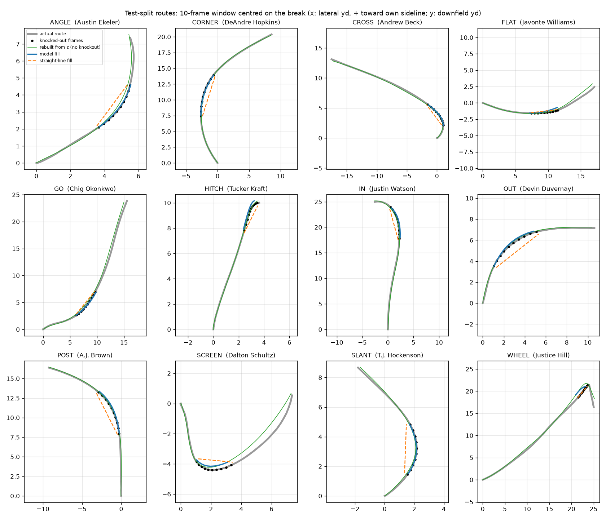
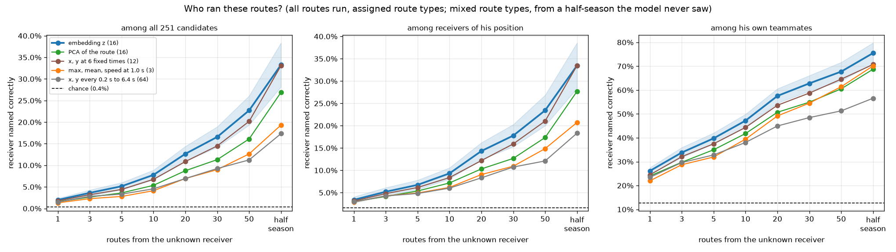
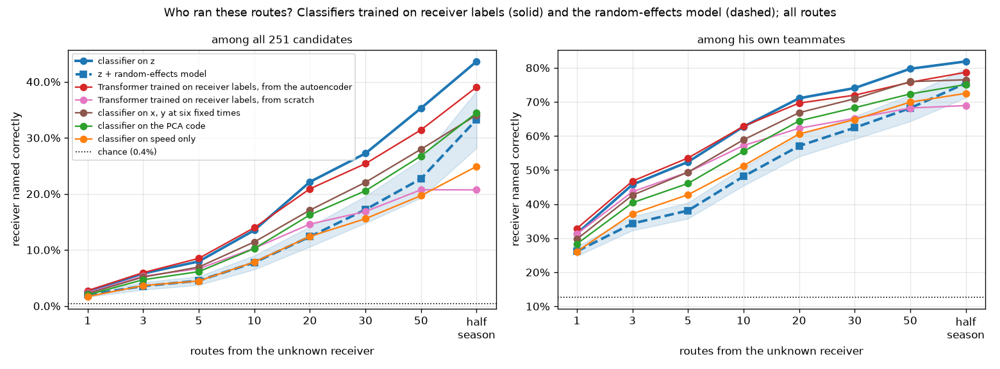
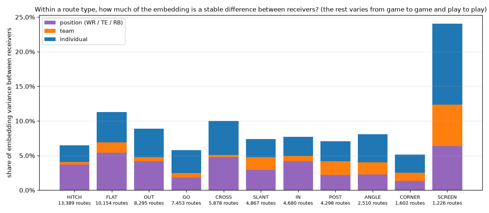
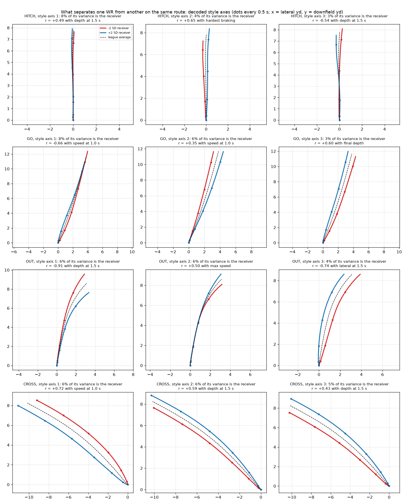
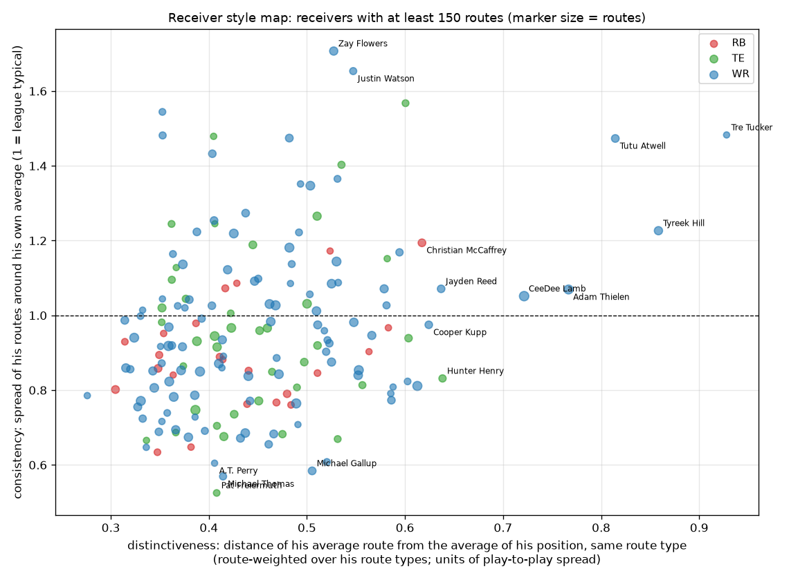

# Route Embedding: can we identify a receiver by how he runs a route?

A self-supervised, BERT-style transformer turns every route into 16 numbers (**z**). It never sees
who ran the route. It is trained by knocking out a window of the route and rebuilding the whole
route, including the missing window, **from z alone**. The receiver analysis then asks how much
of z belongs to the receiver.

```
tracking tables ──> 78,521 route sequences ──> masked-window autoencoder ──> z (16 numbers per route)
                                                                              │
              reconstruction and route type  <── evaluate.py  <───────────────┤
              who ran this route?            <── player_style.py, supervised_ceiling.py
```

## Answer in short

1. **Yes, a receiver can be identified from how he runs his routes, but it takes many routes.**
   Among 251 receivers (chance 0.4%), a classifier on z names the right one 2.6% of the time from
   one route, 13.5% from 10, 35.3% from 50 and 43.6% from a half-season (about 113 routes). Among
   his own teammates it is 31% from one route and 82% from a half-season (chance 13%).
2. **The embedding is not the limit.** A Transformer trained end-to-end on receiver labels does no
   better than a small classifier on the 16 numbers, and the same classifier on hand-made
   descriptions (positions, PCA code, speed) does worse. The self-supervised z already holds what
   the labels can find.
3. **Knocking out windows in training matters.** An autoencoder trained without the knockout
   identifies clearly worse (26.9% from 50 routes against 35.4% at the same budget), and windows
   of only 5-10 frames sit between (29.3%). 8-number codes and the first version's design are also
   clearly worse.
4. **The limits are the route and the data per receiver.** Within a route type only 8% of the
   embedding's variance is a stable difference between receivers; 6% changes from game to game and
   86% from play to play. One route is therefore weak evidence, and a receiver's profile takes many
   routes to learn: the classifier needs about 100 training routes per receiver to beat a simpler
   random-effects model, and both still improve steeply with more data.
5. **Of the stable differences, 45% is position, 12% is team and 43% is the individual.** Speed is
   the largest single ingredient, but speed alone reaches only a little over half of z's accuracy.
6. **16 numbers rebuild a route.** z rebuilds a whole route to 0.08 yd and fills a knocked-out
   1.5 s window at the break to 0.17 yd (a straight line: 1.03 yd). A linear 16-number code (PCA)
   fills windows about as well and copies a complete route more exactly, which says that routes
   are simple, smooth objects.
7. **Receiver metrics come out of the same model:** how distinctive a receiver's routes are (a
   stable trait; Tre Tucker, Tyreek Hill and Tutu Atwell lead), how consistent he is (mostly a
   product of how he is used), and how many routes it takes to measure a plain metric such as
   speed or depth (14-20 routes) reliably.

## Run it

```powershell
python run_pipeline.py --name v2      # every stage; a stage with existing output is skipped
```

| stage | script | writes |
|---|---|---|
| build | `build_sequences.py` | `data/sequences.npz`, `routes_meta.csv`, `build_report.json` |
| test | `test_route_embedding.py` | 43 unit tests |
| train | `train.py` | `runs/<name>/model.pt`, `history.csv`, `summary.json` |
| evaluate | `evaluate.py` | `eval_report.json`, `embeddings.csv`, `reconstructions.png` |
| identify | `identify_receivers.py` | `identification/` (targeted routes, one classifier per route type) |
| style-targeted, style-all | `player_style.py` | `style/targeted/`, `style/all/` |
| supervised | `supervised_ceiling.py` | `supervised/all/` (classifier on z; the other classifiers need `--models`) |
| summary | `compare_runs.py` | `pipeline_summary.json`; `python compare_runs.py` builds `runs/comparison.csv` |

- `python run_pipeline.py --name v2 --from evaluate` redoes a stage and everything after it.
  Options the pipeline does not know (for example `--epochs 3`) go to `train.py`.
- Run inside `Route Embedding/` (the folder name has a space: quote it in shells).
- `data/` and `runs/` are ignored by Git. The inputs are the Step 2.0 tables in
  `EDA/Step 2.0 Route Dataset/data/` (ignored by Git, shared through OneDrive) and
  `EDA/Supplementary Data Analysis/supplementary_data.csv`.

## Data (`build_sequences.py`)

Two kinds of sequence, 78,521 in total, from the 2023 season (272 games):

| kind | what | sequences | receivers | median length |
|---|---|---|---|---|
| `full` | targeted routes, snap to ball arrival (Step 2.0 table A) | 14,048 | 458 | 37 frames |
| `pre` | every route runner, snap to throw (table C) | 64,473 | 505 | 26 frames |

- Untargeted runners have frames only up to the throw, so the `pre` kind is the one that covers
  all routes. A targeted route appears in both kinds.
- **Positions:** WR, TE, RB, FB. Other positions (234 routes) and pre-throw paths shorter than
  1.0 s (45) are dropped.
- **Coordinates:** yards from the receiver's snap position, +x downfield, +y toward his own
  sideline. Targeted routes use the reviewed side from break features v2. The same rule, applied
  to the pre-throw frames, gives the side of untargeted runners; on the targeted routes it
  reproduces the reviewed side in every case.
- **Channels:** `x, y, vx, vy, s, a`, recomputed from smoothed positions (`[1,4,6,4,1]/16`). The
  official `a` is unsigned and exists only before the throw.
- **Length:** padded to 77 frames (7.6 s); 107 full and 116 pre sequences are cut.
- **Split:** by game, 218 / 27 / 27 games (63,698 / 7,712 / 7,111 sequences).
- **Labels:** player, team, position and route label live only in `routes_meta.csv`. The model
  never gets them. Route labels exist only for targeted routes.

## Model (`model.py`, `masking.py`, `train.py`)

```
route with a window knocked out ─> Transformer encoder ─> z (16) ─> decoder ─> whole route
```

- **Inputs:** one token per frame with `x, y, vx, vy, a`, plus a learned time embedding and a
  [CLS] token. Knocked-out frames are replaced by a learned mask token.
  - `vx, vy` are the frame-to-frame change of x and y, so they add no information to the
    professor's "x, y and acceleration". They make the encoder much more precise for the same
    training (see the `x y a` row in the design table).
- **Knockout:** one contiguous window of 8-15 frames (0.8-1.5 s) per route, capped at half the
  route. Single frames are not used, because a straight line already fills a 5-frame gap to
  0.13 yd. 20% of the training routes are shown whole (`--whole-prob`): every later analysis
  embeds complete routes, so the model has to see some.
- **Encoder:** 3 Transformer layers (d_model 64, 4 heads). z is read from [CLS] plus a linear
  readout of every frame's output state, including the states at knocked-out frames, which the
  Transformer has to fill from context.
- **Decoder:** sees only z, never the input frames, so z has to hold the whole route. It is a
  linear map plus a small MLP correction that writes 32 coefficients of fixed "eigen-routes" (the
  principal components of the training routes). The output is smooth by design.
- **Loss:** squared position error on the knocked-out frames + 0.5 x the error on visible frames
  + 0.1 x the error of the frame-to-frame steps (velocity), which keeps fine detail.
- **Size and training:** 264,784 parameters; AdamW, learning rate 3e-3 with warm-up and cosine
  decay, batches of 256 routes of similar length; 40 epochs = 9,960 steps, 23 minutes on 8 CPU
  threads.

Tests check that knocked-out and padded frames cannot reach z, that visible frames do, that
nothing bypasses z, and that cutting a batch to its longest route changes no real frame.

## Results (`runs/v2`)

### 1. Rebuilding routes from 16 numbers

Test split (27 unseen games), targeted routes, median error per route in yards. "PCA fill" is the
linear counterpart of the model: a 16-number PCA code fitted to the visible frames only.

| knocked-out window | z (v2) | PCA fill | straight line | first version (v1) |
|---|---|---|---|---|
| 5 frames, random position | 0.092 | 0.055 | 0.125 | 0.290 |
| 10 frames, random position | 0.084 | 0.097 | 0.380 | 0.319 |
| 15 frames, random position | 0.136 | 0.165 | 0.711 | 0.406 |
| 10 frames, centred on the break | 0.097 | 0.105 | 0.559 | 0.356 |
| 15 frames, centred on the break | 0.166 | 0.183 | 1.031 | 0.548 |
| nothing knocked out (whole route from z) | 0.081 | 0.029 | – | 0.402 |

- **The model fills a 1.5 s window at the break to 0.17 yd,** six times better than a straight
  line, and better than the line on 99% of routes.
- **It matches the linear code on windows of 10 frames or more** (better than PCA fill on 52-60%
  of routes) and is behind on 5-frame gaps, which are shorter than anything it trained on.
- **A complete route is rebuilt to 0.08 yd** (90th percentile 0.17). The PCA code fitted to the
  real frames reaches 0.03 yd; plain PCA on padded routes 0.08 yd.
- **Pre-throw paths of all runners:** whole path 0.053 yd; 15-frame break window 0.24 yd against
  0.34 for PCA fill and 0.81 for a line.
- **Rebuilt routes are as smooth as real ones** (frame-to-frame roughness 0.035 against 0.037;
  v1: 0.253).
- **Why the linear code is so strong:** routes are smooth and low-dimensional. With the route
  length given, 8 principal components already rebuild a route to 0.05 yd.



### 2. z knows the route type without labels

kNN (k = 15) trained on train-split routes, tested on the other two splits:

| features | targeted routes | pre-throw paths |
|---|---|---|
| z | 0.819 | 0.723 |
| PCA, 16 components | 0.807 | 0.707 |
| x, y at six fixed times | 0.670 | 0.575 |

This is also how untargeted routes get a route type: a kNN on z, trained on the labeled targeted
routes, names the route of every pre-throw path (72% accurate on held-out games). "A certain
route" therefore means the supplementary label for targeted routes, and the route type read from
the embedding for all routes.

### 3. Who ran these routes? (`player_style.py`)

**Setup.** Receivers' profiles are built from odd weeks and tested on even weeks, then the
reverse. Within each route type a random-effects model (`player_model.py`) separates the receiver
from game-to-game and play-to-play variation. n routes of an unknown receiver are scored
together; routes of different types add their evidence. Candidates are receivers with enough
routes in both half-seasons, and every candidate is equally likely beforehand.

**All routes run** (pre-throw paths, assigned route types; 251 candidates with at least 40 routes
per half-season; chance 0.40%):

| routes from the unknown receiver | 1 | 3 | 5 | 10 | 20 | 30 | 50 | half-season (~113) |
|---|---|---|---|---|---|---|---|---|
| **z (16 numbers)** | 2.0% | 3.6% | 5.1% | 7.8% | 12.7% | 16.6% | 22.7% | 33.3% |
| x, y at six fixed times (12) | 1.8% | 3.2% | 4.4% | 6.8% | 10.9% | 14.5% | 20.2% | 33.1% |
| PCA, 16 components | 1.6% | 2.6% | 3.6% | 5.4% | 8.7% | 11.3% | 16.1% | 26.9% |
| speed only (max, mean, at 1.0 s) | 1.3% | 2.3% | 2.8% | 4.1% | 6.9% | 9.0% | 12.6% | 19.3% |
| x, y every 0.2 s (64 numbers) | 1.5% | 2.8% | 3.3% | 4.6% | 6.9% | 9.3% | 11.2% | 17.3% |
| z, among receivers of his position (chance 1.6%) | 3.4% | 5.2% | 6.7% | 9.3% | 14.3% | 17.8% | 23.4% | 33.5% |
| z, among his own teammates (chance 12.7%) | 26.1% | 33.8% | 39.8% | 47.2% | 57.5% | 62.8% | 67.7% | 75.5% |

**Targeted routes** (full paths, supplementary labels; 152 candidates with at least 15 routes per
half-season; chance 0.66%):

| routes from the unknown receiver | 1 | 3 | 5 | 10 | 20 | half-season (~31) |
|---|---|---|---|---|---|---|
| **z** | 3.2% | 5.3% | 8.0% | 10.2% | 14.5% | 21.1% |
| x, y at six fixed times | 3.2% | 4.6% | 6.4% | 8.1% | 12.7% | 20.1% |
| PCA, 16 components | 2.8% | 4.2% | 6.0% | 8.6% | 10.5% | 17.4% |
| speed only | 2.2% | 3.6% | 4.5% | 6.1% | 8.3% | 9.5% |
| z, among his own teammates (chance 21.1%) | 37.6% | 44.2% | 50.3% | 56.0% | 61.7% | 66.4% |



The same figure for targeted routes is `figures/v2_identification_targeted.png`.

How to read this:

- **One route is weak evidence.** From one route the right receiver is named 5 times more often
  than chance and is in the top five 7.5% of the time (chance 2.0%). Half of the time he is
  ranked in the top 27% of the 251 candidates.
- **Evidence adds up.** 50 routes: 22.7% (95% interval 19.3-26.1). A half-season: 33.3%
  (28.2-38.4), 83 times chance.
- **z is the best description, by a small margin.** Differences on the same receivers, all
  routes, at 50 routes: z is ahead of PCA by 6.6 points (4.7 to 8.5), of the six-time positions
  by 2.5 (0.6 to 4.5) and of speed by 10.1 (7.2 to 13.0). At a half-season z and the positions
  tie (+0.2, -3.2 to +3.6). With this model twelve hand-picked numbers are nearly as good as the
  embedding; with a classifier trained on receiver labels z is clearly ahead (section 4).
- **More numbers do not help.** The raw route (64 numbers) is the worst description: identity
  sits in a few coarse features, and extra detail only adds noise to the receiver profiles.

Controls:

- **Shuffled receiver labels:** 0.6-0.7% (targeted: 0.8-1.0%). The small excess over chance is
  usage: the model knows how many routes of each type a receiver ran.
- **Not just position:** among receivers of the same position the accuracy is the same (33.5% at
  a half-season, chance 1.6%).
- **Not just team:** among teammates z reaches 26% from one route and 76% from a half-season
  (chance 13%). Speed alone reaches 22% and 70%.
- **Not just where he lines up:** counting a route type run from a different alignment
  (outermost, slot, backfield) as a different route changes nothing (2.2% from one route, 23.1%
  from 50, 32.9% from a half-season).
- **Not learned by the autoencoder:** routes from games the autoencoder trained on are identified
  as often as routes from held-out games (2.05% against 2.07% from one route).
- **First-version protocol** (`identify_receivers.py`: one LDA per route type, candidates with 5+
  routes of that type per half-season, chance 2.5%): z 6.3% from one route and 14.5% from ten;
  positions 6.2% / 14.9%; PCA 6.6% / 13.0%; speed 4.6% / 10.6%. All eight route types beat chance
  (p = 0.02). Hiding the frames after the throw changes nothing (6.6% against 6.7%).

By route type (all routes; one route, and ten routes of that same type; chance 0.4%):

| route type | 1 route | 10 routes | | route type | 1 route | 10 routes |
|---|---|---|---|---|---|---|
| FLAT | 1.7% | 11.9% | | HITCH | 1.3% | 6.1% |
| ANGLE | 1.1% | 10.0% | | POST | 1.6% | 5.1% |
| CROSS | 1.6% | 9.2% | | SLANT | 1.2% | 4.7% |
| OUT | 1.6% | 9.0% | | IN | 1.3% | 4.4% |
| | | | | GO | 1.1% | 3.8% |

Short routes near the line (FLAT, ANGLE) and CROSS and OUT say the most about the receiver; GO
says the least. CORNER and SCREEN are left out: too few receivers have ten of them in a
half-season.

### 4. Is the embedding the limit? (`supervised_ceiling.py`)

The random-effects model of section 3 is linear and Gaussian: it finds the directions of z along
which receivers differ and assumes that every receiver varies around his average in the same
Gaussian way. To see whether the embedding or this readout limits identification, classifiers
were trained on the receiver labels and compared with it on exactly the same task: the same 251
candidates, profiles from one half-season tested on the other, and the same random sets of
routes. Both readouts learn from the receiver labels of the training half-season; only z itself
is learned without them.

- **Classifier on z:** a small MLP on the 16 numbers and the route type.
- **Classifiers on hand-made descriptions:** the same MLP on the positions at six times, the PCA
  code or speed.
- **Transformers trained on receiver labels:** the autoencoder's encoder with a classification
  head, trained on the raw routes (`x, y, vx, vy, a`), starting from the autoencoder's weights or
  from scratch. It reads every frame, so it is not held to 16 numbers.
- **Kept fair:**
  - The classifiers learn how a receiver runs a route, not which routes he runs: how often each
    receiver runs each route type is taken out of their scores (logit adjustment).
  - Size and stopping time are chosen on held-out games of the training half-season.
  - Several routes are combined by adding their log-likelihoods, as in the random-effects model.
  - With shuffled receiver labels the classifier on z stays at chance (0.2-0.4%).

All routes, 251 candidates, chance 0.40%:

| routes from the unknown receiver | 1 | 10 | 50 | half-season |
|---|---|---|---|---|
| z + random-effects model (section 3) | 2.0% | 7.8% | 22.7% | 33.3% |
| **classifier on z** | **2.6%** | **13.5%** | **35.3%** | **43.6%** |
| classifier on z and all hand-made descriptions | 2.5% | 13.4% | 33.8% | 42.4% |
| classifier on x, y at six fixed times | 2.2% | 11.4% | 28.0% | 34.1% |
| classifier on the PCA code | 2.0% | 10.2% | 26.8% | 34.5% |
| classifier on speed only | 1.7% | 7.8% | 19.7% | 24.9% |
| Transformer trained on receiver labels, from the autoencoder | 2.7% | 14.0% | 31.4% | 39.0% |
| Transformer trained on receiver labels, from scratch | 2.4% | 10.3% | 20.7% | 20.7% |
| classifier on z, among his own teammates (chance 12.7%) | 31.3% | 62.7% | 79.7% | 81.9% |



- **The readout was a limit.** On the same 16 numbers the classifier is ahead of the
  random-effects model by 5.8 points from 10 routes (95% interval 4.3 to 7.2) and by 12.6 from 50
  (9.0 to 16.1). Unlike the random-effects model, it is not bound to a linear, Gaussian form.
- **The embedding is not the limit.** Training the whole Transformer on receiver labels does not
  beat the classifier on z. Started from the autoencoder it is +0.5 points from 10 routes (-0.8 to
  +1.7) and -3.9 from 50 (-7.3 to -0.5); from scratch it is -14.6 from 50. Adding every hand-made
  description to z adds nothing (-1.5 from 50, -4.0 to +1.0). The self-supervised 16 numbers
  already hold what the labels can find in these routes.
- **z beats the hand-made descriptions once the readout is strong.** From 50 routes, against the
  classifier on z: positions at six times -7.3 points (-10.1 to -4.5), PCA code -8.5, speed -15.6.
  With the random-effects model z and the positions had tied.
- **Where he lines up explains part of the lead.** With route type and alignment held fixed
  (outermost, slot, backfield), the classifier on z still leads, but by half as much: 29.7%
  against 23.4% from 50 routes (+6.3 points, 3.2 to 9.5), 37.3% against 32.9% from a half-season.

**Classifiers need data.** A receiver has about 113 routes per half-season here. Both readouts
were also trained on a random share of them and tested on the same full half-season:

| training routes used | random-effects, 50 routes | classifier on z, 50 routes | random-effects, half-season | classifier on z, half-season |
|---|---|---|---|---|
| 25% | 9.0% | 3.3% | 12.9% | 3.6% |
| 50% | 14.7% | 10.2% | 22.1% | 11.6% |
| 100% | 22.7% | 35.3% | 33.3% | 43.6% |

- The classifier only overtakes the random-effects model with the full half-season.
- On the targeted routes (about 31 per receiver and half-season) every classifier is worse than
  the random-effects model (21.1% from a half-season), and the Transformer trained from scratch
  stays at chance.
- Neither readout has levelled off, so these accuracies are limited by one season of data as much
  as by the routes. With few routes per receiver, the random-effects model is the better choice.

### 5. Where the differences between receivers come from

Share of the embedding's variance within a route type (route-weighted over route types):

| | all routes | targeted routes |
|---|---|---|
| stable difference between receivers | 8.3% | 10.9% |
| game to game (same receiver, different game) | 6.2% | 5.6% |
| play to play | 85.5% | 83.4% |

The receiver part splits further. "Team" is what two different receivers on the same team share;
"individual" is what is left after position and team:

| part of the between-receiver share | all routes | targeted routes |
|---|---|---|
| position (WR / TE / RB) | 45% | 43% |
| team | 12% | 10% |
| individual | 43% | 47% |

- **Most of a route is the play, not the player.** Coverage, the play call and the throw move a
  route far more than the receiver's habits do. This is why one route identifies so weakly.
- **Scheme leaves a mark.** The team can be named from routes of receivers the model never saw:
  4.5% from one route, 7.3% from 10, 12.6% from 30 (chance 3.1%). Speed alone: 7.0% from 30.
- **Estimation.** The receiver share is the agreement between a receiver's odd-week and even-week
  averages, so noise shared within a game cannot be counted as a receiver difference.



### 6. Receiver metrics

**Style axes.** Within a route type the model finds the directions of z that separate receivers
most. Decoding them shows what they are: mostly speed off the line, depth at a fixed time and how
hard the receiver brakes.



**Profiles replicate.** Correlation across receivers between their odd-week and even-week average
on the first four style axes (axes chosen on one half only): 0.65, 0.49, 0.29, 0.31. The model
expected 0.67, 0.53, 0.41, 0.35, so it is calibrated.

**Two metrics per receiver and route type** (`style/all/player_style.csv`, `receivers.csv`),
measured against receivers of the same position:

- **Distinctiveness:** how far his average route sits from the average route of his position, in
  units of the typical play-to-play spread.
  - It is a real trait: more distinctive receivers are identified more often (r = 0.52 with the
    50-route accuracy), and the metric agrees between half-seasons (r = 0.33 per receiver and
    route type).
  - Most distinctive, receivers with 150+ routes: Tre Tucker, Tyreek Hill, Tutu Atwell (three
    speed receivers), Adam Thielen, CeeDee Lamb, Hunter Henry, Jayden Reed, Cooper Kupp,
    Christian McCaffrey, Davante Adams.
- **Consistency:** the spread of his routes around his own average (1 = league typical).
  - Most repeatable: Pat Freiermuth, Michael Thomas, Michael Gallup, A.T. Perry, Zay Jones.
    Least: Zay Flowers, Justin Watson, Noah Gray, Olamide Zaccheaus, Tre Tucker, Tank Dell.
  - It is a weak trait (r = 0.16 between half-seasons) and unrelated to being identified
    (r = -0.08). It mostly reflects how varied a receiver's assignments are (motion, alignment),
    so read it as usage, not skill.
- **Most identifiable from 50 routes:** Tre Tucker (100%), Christian McCaffrey (90%),
  Cooper Kupp, Travis Kelce, Tyler Higbee (88%), Adam Thielen, Rashee Rice, Jameson Williams (85%).



**Plain route metrics** (`style/all/metric_stability.csv`). The same split for simple numbers: how
much of a metric's variance, within a route type, is a stable difference between receivers, and
how many routes it takes to measure a receiver's value with reliability 0.7.

| metric | stable receiver share | of which individual | routes needed |
|---|---|---|---|
| depth at 1.5 s | 14.2% | 32% | 14 |
| speed at 1.0 s | 13.8% | 39% | 15 |
| max speed | 12.3% | 46% | 17 |
| mean speed | 10.7% | 43% | 20 |
| hardest braking | 9.1% | 50% | 23 |
| lateral position at 1.5 s | 8.0% | 51% | 27 |
| final depth | 7.4% | 41% | 29 |
| path straightness | 5.2% | 30% | 43 |
| route duration | 4.6% | 26% | 48 |
| final lateral position | 4.4% | 54% | 51 |

Tempo off the line and speed are the most receiver-specific numbers. Route duration is the least,
and 45% of its receiver share is team: when the ball comes out belongs to the quarterback.

### 7. What matters in the model design

Each row changes one thing. Rows 2-9 train on targeted routes only for 2,700 steps. Errors are on
the test split of the targeted routes. Identification is from 50 routes among the 251 candidates
of all routes (section 4), with each run's own z and route types; its 95% intervals are about
±4 points.

| run | change | whole route (yd) | 15-frame break window (yd) | route type | random-effects, 50 routes | classifier on z, 50 routes |
|---|---|---|---|---|---|---|
| `v1` | first version (see below) | 0.402 | 0.548 | 0.800 | 20.6% | 25.3% |
| `abl_base` | new design, targeted routes only | 0.210 | 0.283 | 0.827 | 20.1% | 35.4% |
| `abl_z8` | z with 8 numbers | 0.260 | 0.307 | 0.825 | 15.4% | 25.8% |
| `abl_z32` | z with 32 numbers | 0.234 | 0.282 | 0.830 | 24.1% | 33.4% |
| `abl_w5-10` | windows of 5-10 frames | 0.162 | 0.638 | 0.821 | 21.2% | 29.3% |
| `abl_w10-20` | windows of 10-20 frames | 0.302 | 0.228 | 0.825 | 20.0% | 32.8% |
| `abl_nomask` | no knockout at all | 0.095 | 2.939 | 0.830 | 19.5% | 26.9% |
| `abl_xya` | inputs `x y a` only | 0.295 | 0.484 | 0.832 | 22.0% | 30.6% |
| `abl_alldata_steps` | all routes, same 2,700 steps | 0.267 | 0.358 | 0.826 | 21.9% | 33.5% |
| `abl_always_knockout` | all routes, 9,960 steps, no whole routes | 0.178 | 0.174 | 0.824 | 23.6% | 37.1% |
| **`v2`** | all routes, 9,960 steps, 20% whole routes | **0.081** | **0.166** | 0.819 | 22.7% | 35.3% |

- **The knockout puts the receiver into z.** With the classifier, an autoencoder that never had
  windows knocked out names the receiver from 50 routes 26.9% of the time, against 35.4% with
  8-15-frame windows at the same budget. Windows of 5-10 frames sit between (29.3%); 10-20 frames
  are about as good as 8-15 (32.8%). With the random-effects model these runs look alike
  (19.5-21.2%): only the stronger readout shows the difference.
- **The knockout is what teaches filling.** Without it the model copies a complete route best
  (0.095 yd) but cannot fill a window at all (2.9 yd, worse than a straight line).
- **Window width is a trade for reconstruction.** Narrow windows rebuild complete routes better;
  wide windows fill long gaps better. 8-15 frames sits between.
- **16 numbers are enough.** 32 are no better at this budget; 8 lose on everything, including
  identification (25.8% from 50 routes).
- **Velocity inputs matter** (0.210 against 0.295 yd for the whole route, 35.4% against 30.6%
  from 50 routes), although they add no information.
- **The first version's z is clearly worse for identification** (25.3% against 35.3% from 50
  routes), which the random-effects model could not show.
- **Show some routes whole.** A model that always saw a knocked-out window rebuilt a complete
  route worse (0.178 yd) than the same route with a window removed (0.108 yd). With 20% whole
  routes it is 0.081 yd and the window filling is unchanged.
- **More data helps where the data is.** At equal steps, adding the pre-throw paths makes the
  pre-throw paths better (0.19 against 0.25 yd) and the targeted routes worse; with the full
  budget both are best.
- One training run per row, so differences of a few points in identification are noise.

## Limits

- One season. Profiles from odd weeks are tested on even weeks; nothing is tested across seasons.
- Untargeted routes end at the throw and have no route label. Their route type is read from z
  (72% accurate), so the all-routes analysis is about "a route of this shape". The targeted-route
  analysis uses the real labels and agrees with it.
- Position, team and alignment are controlled one at a time, not all at once. Part of the
  "individual" share may still be role (what a receiver is asked to do), not habit.
- Accuracy depends on the candidate pool: 251 receivers with 40+ routes per half-season, 152 for
  targeted routes.
- Consistency reflects usage as much as the receiver.
- A linear 16-number code still copies a fully visible route more exactly than z (0.03 yd against
  0.08 yd).
- The classifiers were tuned lightly: four MLP sizes and one Transformer setting, one training run
  each. A better-tuned Transformer could beat the classifier on z; "the embedding is not the
  limit" holds for the models tried here.

## Files

| file | role |
|---|---|
| `run_pipeline.py` | one command for all stages |
| `build_sequences.py`, `route_sequences.py` | sequences from the Step 2.0 tables; corrected side, kinematics, padding, game split |
| `masking.py` | training knockout, evaluation windows, straight-line fill |
| `model.py` | `RouteAutoencoder`, losses |
| `train.py` | training loop |
| `evaluate.py` | reconstruction against the line and PCA, route type, assigned route types, `embeddings.csv` |
| `player_model.py` | random-effects model: receiver, game and play variation within a route type |
| `player_style.py` | identification from n routes, controls, variance split, receiver and metric tables, figures |
| `supervised_ceiling.py` | classifiers trained on receiver labels, compared with the random-effects model on the same task |
| `identify_receivers.py` | first-version protocol: one LDA per route type on targeted routes |
| `compare_runs.py` | headline numbers of several runs in one table |
| `test_route_embedding.py` | unit tests |

Outputs of `player_style.py` in `runs/<name>/style/<population>/`: `identification.json`,
`identification_by_type.csv`, `variance.csv`, `metric_stability.csv`, `reliability.csv`,
`scheme.json`, `player_style.csv`, `receivers.csv` and four figures. `--condition type+alignment`
writes the alignment control to `style/<population>_alignment/`.

Outputs of `supervised_ceiling.py` in `runs/<name>/supervised/<population>/`: the scores of each
model and training half (`<model>_<half>.npz`, so models can be trained in separate processes),
`supervised.json` and `supervised_curve.png`. `--train-frac` and `--condition type+alignment`
write to their own folders. Training every model for one population takes about 40 minutes with
the jobs run side by side.

## Environment

Python 3.14 and PyTorch 2.15.0 (CPU) on Windows, 10 cores, no GPU. One thread per training
process is the most efficient, so ablations run side by side. On this machine Smart App Control
once blocked `import torch` (`WinError 4551`, `torch_python.dll`); later imports worked. If the
error comes back, check Windows Security → App & browser control, or run in WSL or Colab.

## First version (v1)

The first version (PR #5, `runs/v1`) used the targeted routes only, a [CLS]-only readout, a
Transformer decoder and inputs `x, y, s, a`. Its numbers are the `v1` rows above: 0.40 yd for a
whole route with visible jitter, 0.55 yd for a 15-frame break window, and, with the random-effects
model, the same identification as every later model. With a classifier on z it is clearly worse
(25.3% from 50 routes against 35.3%). Its figures are kept in `figures/v1_*.png`. To train it again:
`python train.py --name v1 --kinds full --readout cls --decoder transformer --inputs x y s a
--lr 1e-3 --vel-weight 0 --whole-prob 0 --no-bucket --epochs 80`.

## Next steps

1. **More data per receiver:** both readouts still improve steeply with more training routes
   (section 4). Add another season; do receiver profiles carry over between seasons and after a
   team change?
2. **Role against habit:** condition on route type, alignment and coverage together. Alignment
   already explains half of the classifier's lead.
3. **Use the metrics:** relate distinctiveness and the style axes to separation and to catches.
4. **Route disguise:** hide the rest of a route after its first second and let the model predict
   it. Receivers whose routes are hard to predict early are hard for a defense to read.
5. **Sharper reconstruction:** train longer or with a wider model, and compare with the linear
   code on fully visible routes.
